 

<a href="https://gityus13.dev"><b>Live site</b></a>
&ensp;/&ensp;
<a href="#about">About</a>
&ensp;/&ensp;
<a href="#the-site">The site</a>
&ensp;/&ensp;
<a href="#selected-work">Selected work</a>
&ensp;/&ensp;
<a href="#contact">Contact</a>

  

 

## About

Developer based in Baku, Azerbaijan, building web applications, software tools, and hardware projects. The work is guided by clean engineering, practical solutions, and continuous learning.

This repository is the source of my portfolio at [gityus13.dev](https://gityus13.dev).

  

## The site

The portfolio reads my public GitHub profile and repositories each time it loads, so it stays current without manual edits.

| Feature | Details |
| :-- | :-- |
| **Live repository grid** | Description, language, stars, forks, topics, and last push for every public repository. |
| **Search, sort, filter** | Search by name, description, or topic. Six sort orders. Filters for original work, forks, archived repositories, live sites, and language. |
| **Insights** | Language breakdown across repositories and a 26-week grid of recent push activity. |
| **Pinned projects** | Featured repositories are sorted first and marked. |
| **Themes and motion** | Light and dark themes, GSAP animation, and full respect for reduced-motion settings. |
| **Reliable by design** | Responses are cached for ten minutes. If GitHub rate limits the page, saved data is shown instead of an empty screen. |

## Selected work

The live site lists every repository. A few representative ones:

| Project | Language | Description |
| :-- | :-- | :-- |
| [Jarvis](https://github.com/Gityus13/jarvis) | JavaScript | Personal AI assistant |
| [PiPanel](https://github.com/Gityus13/pipanel) | JavaScript | Raspberry Pi control dashboard |
| [Pulse News](https://github.com/Gityus13/pulse-news) | HTML | News aggregation platform |
| [Cipher Lang](https://github.com/Gityus13/cipher-lang) | HTML | Custom cipher language tool |
| [DJ Yusif](https://github.com/Gityus13/djyusif) | HTML | Website and booking for [djyusif.com](https://djyusif.com) |
| [FoodServ.az](https://github.com/Gityus13/foodserv.az) | HTML | Food service platform |

## Contact

- GitHub: [@Gityus13](https://github.com/Gityus13)
- Website: [gityus13.dev](https://gityus13.dev)
- Other: [dev.to](https://dev.to/gityus13)

## License

Released under the [MIT License](LICENSE). Copyright (c) 2026 Gityus13.

 

  

