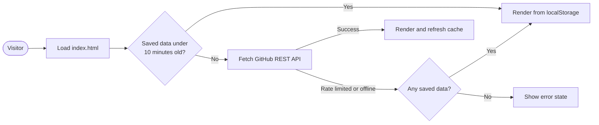

<div align="center">

<picture>
  <source media="(prefers-color-scheme: dark)" srcset="docs/logo-on-dark.png">
  
</picture>

<h1>Gityus13</h1>

<p>
  Developer building web applications, software tools, and hardware projects.<br/>
  A portfolio site that builds itself from the GitHub API.
</p>

<p>
  <a href="https://gityus13.dev"><b>Live site</b></a>
  &ensp;/&ensp;
  <a href="#features">Features</a>
  &ensp;/&ensp;
  <a href="#getting-started">Getting started</a>
  &ensp;/&ensp;
  <a href="#configuration">Configuration</a>
</p>

<p>
  <a href="https://gityus13.dev"></a>
  <a href="LICENSE"></a>
  <a href="https://github.com/Gityus13/gityus13.github.io/commits/main"></a>
</p>

</div>

<br/>

## Overview

This repository is the source of [gityus13.dev](https://gityus13.dev). It is a single static page with no build step and no backend. On load, the page reads the public profile and repositories of a GitHub account and renders them as a searchable, filterable portfolio, so the site stays current without manual edits.

## Features

| Area | Details |
| :-- | :-- |
| **Repository grid** | Every public repository with description, primary language, stars, forks, topics, and time of last push. |
| **Search, sort, filter** | Free-text search across names, descriptions, and topics. Six sort orders. Filters for original work, forks, archived repositories, repositories with a live site, and individual languages. |
| **Pinned projects** | Repositories whose names match the `PINNED` list are sorted first and marked as featured. |
| **Repository detail** | A modal with repository statistics, topics, license, default branch, and a one-click copy of the clone command. |
| **Language breakdown** | Share of repositories by primary language. |
| **Push activity** | A 26-week grid showing the days on which repositories were last pushed to. |
| **Light and dark themes** | The choice is remembered and applied before first paint, so there is no flash. |
| **Motion** | Entrance animation, scroll reveals, card tilt, and magnetic buttons via GSAP. All of it is skipped when the visitor has `prefers-reduced-motion` enabled. |
| **Resilience** | Responses are cached locally. If the API is rate limited or unreachable, the page falls back to saved data and says so. |
| **Responsive layout** | Designed from small phones to wide desktops, with navigation available at every width. |
| **Custom 404** | A branded error page that matches the main design. |

## How it works



Unauthenticated GitHub API requests are limited to 60 per hour per IP address. The 10-minute cache keeps ordinary browsing well under that limit. Older saved data is shown immediately while a fresh request runs in the background.

## Tech stack

| Layer | Technology |
| :-- | :-- |
| Markup and styling | HTML5, CSS3 with custom properties for theming |
| Logic | Vanilla JavaScript, no framework and no bundler |
| Data | GitHub REST API v3 |
| Animation | GSAP 3.14.2 and ScrollTrigger, loaded from jsDelivr |
| Typography | Inter, Space Grotesk, JetBrains Mono via Google Fonts |
| Hosting | GitHub Pages with a custom domain |

## Getting started

There is nothing to install. Clone the repository and serve the folder with any static file server:

```bash
git clone https://github.com/Gityus13/gityus13.github.io.git
cd gityus13.github.io
python3 -m http.server 8000
```

Open <http://localhost:8000>. GSAP and fonts load from CDNs, so animations and web fonts need a network connection. The page remains fully usable without them.

## Configuration

Everything you are likely to change sits at the top of the main `<script>` block in `index.html`.

| Constant | Default | Purpose |
| :-- | :-- | :-- |
| `USERNAME` | `'Gityus13'` | GitHub account whose profile and repositories are displayed. |
| `PINNED` | `['jarvis', 'stacklens', 'repoask']` | Name fragments, case-insensitive. Matching repositories are featured and sorted first. |
| `EXCLUDE` | `[]` | Exact repository names to hide from the grid. |
| `PAGE_SIZE` | `12` | Repositories shown before the Load more button. |

The hero biography, avatar, location, and website link are read from the GitHub profile. To change them, edit the profile on GitHub.

## Project structure

```text
.
├── index.html                    Portfolio page: markup, styles, and scripts
├── 404.html                      Custom error page
├── logo.png                      Site logo and favicon
├── gityus13.svg                  Wordmark
├── docs/
│   ├── logo-on-dark.png          README header logo for dark themes
│   └── logo-on-light.png         README header logo for light themes
├── CNAME                         Custom domain: gityus13.dev
├── robots.txt                    Crawler rules
├── sitemap.xml                   Sitemap
├── google915ed6b5aa6c42dd.html   Search Console ownership file, do not remove
├── LICENSE                       MIT
└── README.md
```

## Deployment

The site is served by GitHub Pages from the root of the `main` branch. Pushing to `main` publishes the change, usually within a minute.

- **Domain.** The `CNAME` file sets `gityus13.dev`. DNS for that domain must point to GitHub Pages, and HTTPS can be enforced under Settings, then Pages.
- **Search.** `index.html` declares a canonical URL. `robots.txt` points crawlers to `sitemap.xml`, which should be updated whenever a new project page is published under the domain.

## Selected work

The live site lists every repository. A few representative ones:

| Project | Language | Description |
| :-- | :-- | :-- |
| [Jarvis](https://github.com/Gityus13/jarvis) | JavaScript | Personal AI assistant |
| [PiPanel](https://github.com/Gityus13/pipanel) | JavaScript | Raspberry Pi control dashboard |
| [Pulse News](https://github.com/Gityus13/pulse-news) | HTML | News aggregation platform |
| [Cipher Lang](https://github.com/Gityus13/cipher-lang) | HTML | Custom cipher language tool |
| [DJ Yusif](https://github.com/Gityus13/djyusif) | HTML | Website and booking for [djyusif.com](https://djyusif.com) |
| [FoodServ.az](https://github.com/Gityus13/foodserv.az) | HTML | Food service platform |

## Contact

Based in Baku, Azerbaijan.

- GitHub: [@Gityus13](https://github.com/Gityus13)
- Website: [djyusif.com](https://djyusif.com)
- Issues and suggestions: [open an issue](https://github.com/Gityus13/gityus13.github.io/issues)

## License

Released under the [MIT License](LICENSE). Copyright (c) 2026 Gityus13.
